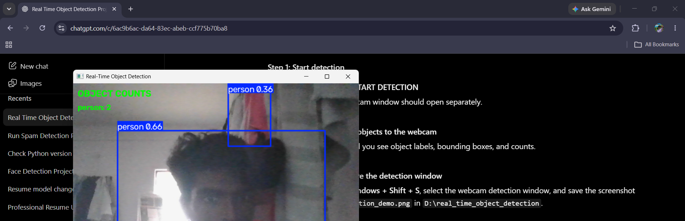

# Real-Time Object Detection

A real-time object detection application built with Python, YOLO, OpenCV, and Tkinter. It detects objects through a webcam, displays bounding boxes, and counts detected objects.

## Project Demo



## Features

- Real-time object detection using a webcam
- Object names and bounding boxes
- Live object counting
- Save detection images
- Save detection history in CSV format
- GUI with Start Detection, Stop Detection, Open Output Folder, and View Detection History buttons

## Technologies Used

- Python
- YOLO (Ultralytics)
- OpenCV
- Tkinter
- CSV

## Project Structure

- `main.py` — runs real-time object detection
- `gui.py` — provides the graphical user interface
- `history.py` — saves detection history
- `yolo26n.pt` — YOLO model weights
- `outputs/` — stores detection images and history locally

## Installation

1. Install Python.
2. Open a terminal in the project folder.
3. Install the required packages:

   ```bash
   pip install -r requirements.txt
   ```

4. Make sure `yolo26n.pt` is in the project folder.

## How to Run

1. Open a terminal in the project folder.
2. Run the application:

   ```bash
   python gui.py
   ```

3. Click **START DETECTION**.
4. Press `S` in the webcam window to save a detection image and history.
5. Press `Q` in the webcam window to exit detection.

## Author

Add your name here.

## Future Improvements

- Generate object detection reports and charts
- Support detection from uploaded images and videos
- Improve detection performance